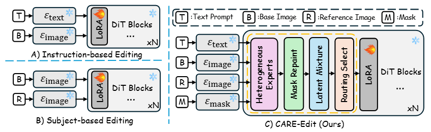
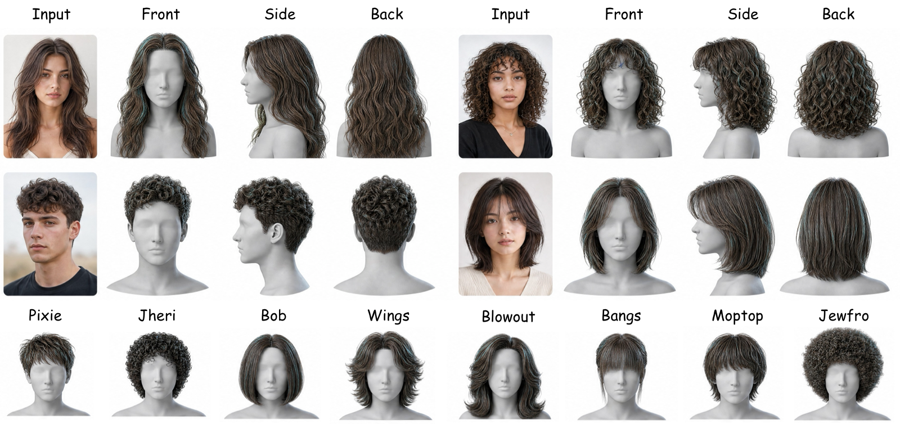
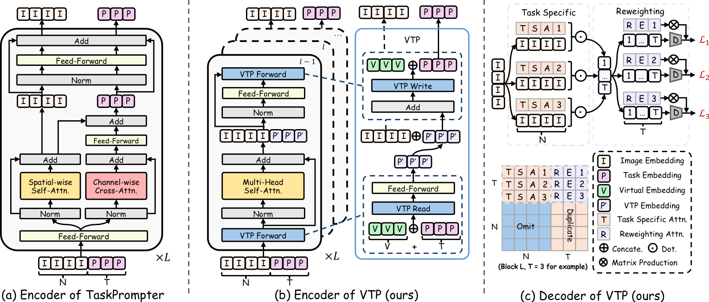
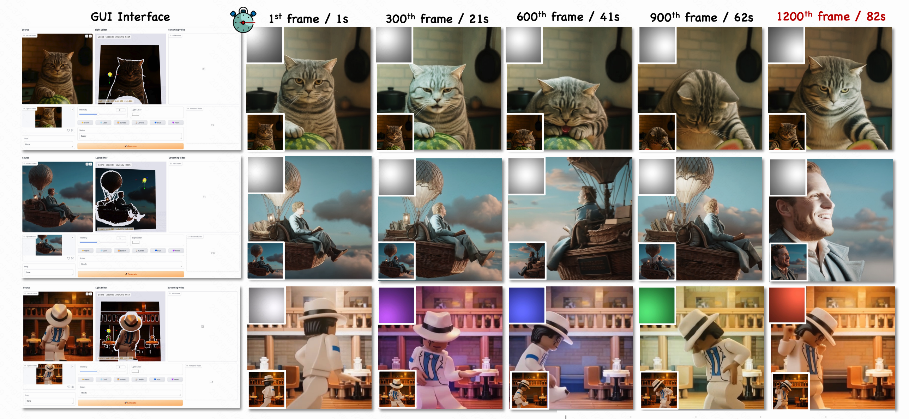
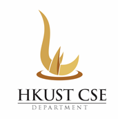
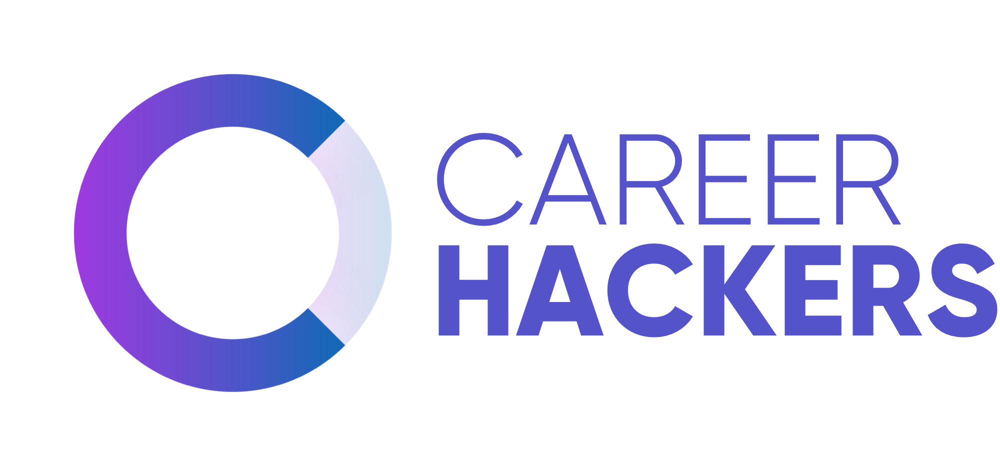

  
I'm a third-year Ph.D. student advised by <a href="https://www.danxurgb.net">Prof. Dan Xu</a> at The Hong Kong University of Science and Technology (<a href="https://hkust.edu.hk/">HKUST</a>). I earned my bachelor’s degree in Computer Science and Electronic Engineering from HKUST. I also spent a semester on exchange at <a href="https://ethz.ch/en.html">ETH Zurich</a>, where I was fortunate to work with <a href="https://insait.ai/dr-danda-paudel/">Prof. Danda Paudel</a> on 3D gaze estimation and eye modeling.

  
My research lies in Generative AI, with a focus on <strong>Controllable</strong> and <strong>Efficient</strong> image/video generation. More recently, I have been increasingly interested in how such generative models can serve for <strong>Embodied Intelligence</strong>. Feel free to reach out for discussions and collaborations.

## 🗞️ News

  <ul>
    <li><strong>Sep 2026</strong>Two papers (SAFE-Hair and VTP) on <strong>3D Generation</strong> and <strong>Multi-task Learning</strong> accepted by NeurIPS 2026. Thanks to <a href="https://www.danxurgb.net">Prof. Dan Xu</a> for his great help and all coauthors. Appreciate the dedication of <a href="https://jacky1128.github.io/">Zedong Wang</a>!</li>
    <li><strong>Jul 2026</strong>One co-authored <a href="https://living-lighting.github.io/">paper</a> (<em>LiveLight</em>) on <strong>Video Relighting</strong> accepted by ACM TOG 2026. Appreciate the dedication of <a href="https://mayuelala.github.io/">Yue Ma</a>!</li>
    <li><strong>Mar 2026</strong>One <a href="https://care-edit.github.io/">paper</a> (<em>CARE-Edit</em>) on <strong>Image Editing</strong> accepted by CVPR 2026. Thanks to <a href="https://www.danxurgb.net">Prof. Dan Xu</a> for his great help and all coauthors. Appreciate the dedication of <a href="https://jacky1128.github.io/">Zedong Wang</a>!</li>
    <li><strong>Mar 2026</strong>One co-authored <a href="https://easy-vfx.github.io/">paper</a> (<em>EasyVFX</em>) on <strong>VFX Generation</strong> accepted by SIGGRAPH 2026. Appreciate the dedication of <a href="https://mayuelala.github.io/">Yue Ma</a>!</li>
    <li><strong>Aug 2025</strong>One co-authored survey on <strong>Controllable Video Generation</strong> released on <em><a href="https://arxiv.org/abs/2507.16869">arXiv</a></em>. Appreciate the dedication of <a href="https://mayuelala.github.io/">Yue Ma</a>!</li>
    <li><strong>Jul 2025</strong>One co-authored <a href="https://copart3d.github.io/">paper</a> (<em>CoPart</em>) on <strong>3D Generation</strong> accepted by ICCV 2025. Appreciate the dedication of <a href="https://hkdsc.github.io/">Shaocong Dong</a>!</li>
    <li><strong>Jul 2025</strong>One paper on <strong>Talking Head Generation</strong> released on <em><a href="https://arxiv.org/abs/2507.05092">arXiv</a></em>.</li>
    <li><strong>Jun 2024</strong>I’ve graduated from HKUST with the <a href="https://registry.hkust.edu.hk/academic-achievement-medal">Academic Achievement Medal</a>. Thank you all my mentors and friends!</li>
  </ul>

  <button type="button" onclick="var l=document.getElementById('news-list');this.textContent=l.classList.toggle('expanded')?'Show less ↑':'Show more ↓';">Show more ↓</button>

## 📚 Selected Publications

<!-- CARE-Edit -->

  

    

      
CVPR2026

      
    

  

  

    
<a href="https://arxiv.org/abs/2603.08589">CARE-Edit: Condition-Aware Routing of Experts for Contextual Image Editing</a>

    
<strong>Yucheng Wang</strong>*, Zedong Wang*, Yuetong Wu, Yue Ma, Dan Xu  

    
<a class="pub-link" href="https://arxiv.org/abs/2603.08589"><i class="fas fa-file-alt" aria-hidden="true"></i>Paper</a> <a class="pub-link" href="https://github.com/CARE-Edit/Code"><i class="fab fa-github" aria-hidden="true"></i>Code</a> <a class="pub-link" href="https://care-edit.github.io/"><i class="fas fa-globe" aria-hidden="true"></i>Project Page</a>

    
IEEE/CVF Conference on Computer Vision and Pattern Recognition (CVPR), 2026

  

<!-- SAFE-Hair -->

  

    

      
NeurIPS2026

      
    

  

  

    
<a href="https://arxiv.org/abs/2611.12037">SAFE-Hair: Scalp-Anchored Fields for Exportable Single-View Hair Reconstruction</a>

    
<strong>Yucheng Wang</strong>*, Zedong Wang*, Yuetong Wu, Yue Ma, Dan Xu  

    
<a class="pub-link" href="https://arxiv.org/abs/2611.12037"><i class="fas fa-file-alt" aria-hidden="true"></i>Paper</a> <a class="pub-link" href="https://github.com/SAFE-Hair/Code"><i class="fab fa-github" aria-hidden="true"></i>Code</a> <a class="pub-link" href="https://safe-hair.github.io/"><i class="fas fa-globe" aria-hidden="true"></i>Project Page</a>

    
Conference on Neural Information Processing Systems (NeurIPS), 2026

  

<!-- VTP -->

  

    

      
NeurIPS2026

      
    

  

  

    
<a href="https://arxiv.org/abs/2611.11041">Virtual Task Prompting for Multi-Task Scene Understanding</a>

    
Zedong Wang*, <strong>Yucheng Wang</strong>*, Dan Xu  

    
<a class="pub-link" href="https://arxiv.org/abs/2611.11041"><i class="fas fa-file-alt" aria-hidden="true"></i>Paper</a> <a class="pub-link" href="https://jacky1128.github.io/VTP/"><i class="fas fa-globe" aria-hidden="true"></i>Project Page</a>

    
Conference on Neural Information Processing Systems (NeurIPS), 2026

  

<!-- LiveLight -->

  

    

      
TOG2026

      
    

  

  

    
<a href="https://living-lighting.github.io/">LiveLight: Real-time Streaming Video Relighting with Interactive Control</a>

    
Yue Ma, Jiangming Wang, <strong>Yucheng Wang</strong>, Xilai Wang, Zhiyuan Li, Xinyu Wang, Hongyu Liu, Ruofan Liang, Songchun Zhang, Yuxuan Xue, Qifeng Chen  

    
<a class="pub-link" href="https://arxiv.org/abs/2608.01771"><i class="fas fa-file-alt" aria-hidden="true"></i>Paper</a> <a class="pub-link" href="https://github.com/mayuelala/LiveLight"><i class="fab fa-github" aria-hidden="true"></i>Code</a> <a class="pub-link" href="https://living-lighting.github.io/"><i class="fas fa-globe" aria-hidden="true"></i>Project Page</a>

    
ACM Transactions on Graphics (TOG), 2026

  

  <a class="pubs-more-btn" href="/publications/">View Full Publication List →</a>

## 🎓 Education

<ul class="section-timeline">
  <li>
    

      The Hong Kong University of Science and Technology
      2024 - Present
      Doctor of Philosophy, Computer Science
    

    
  </li>
  <li>
    

      ETH Zurich
      2023 Spring
      Exchange student, Computer Science
    

    
  </li>
  <li>
    

      The Hong Kong University of Science and Technology
      2020 - 2024 with Academic Achievement Medal
      Bachelor of Science, Computer Science
      Bachelor of Engineering, Electronic Engineering (Double Major)
    

    
  </li>
</ul>

## 💼 Experience

<ul class="section-timeline">
  <!-- <li>
    

      Kling AI, Kuaishou Technology
      Jul 2026 - Present
      Research Intern
      Focus: Embodied AI
    

    
  </li> -->
  <li>
    

      SmartMore
      Nov 2023 - Jan 2024
      Research Intern, Mentored by: <a href="https://julianjuaner.github.io/">Dr. Yuechen Zhang</a> and <a href="https://yukangchen.com/">Dr. Yukang Chen</a>
      Focus: Vision-Language Model
    

    
  </li>
  <li>
    

      Computer Vision Laboratory @ETH Zurich 
      Aug 2023 - Nov 2023
      Research Intern, Mentored by: <a href="https://insait.ai/dr-danda-paudel/">Prof. Danda Paudel</a>
      Focus: Generative Model
    

    
  </li>
  <!-- <li>
    

      Career Hackers @HKSTP
      Jun 2022 - Aug 2022
      Backend Developer, Mentored by: <a href="https://www.linkedin.com/in/justin-wang-lap-tang-5523b9175/">Mr. Justin Tang</a>
      Focus: Amazon Web Services and APIs
    

    
  </li>-->
 </ul>

## 🎖 Selected Awards

<ul class="section-honors">
  <li><em>2024</em> &nbsp;&nbsp; Hong Kong PhD Fellowship Scheme</li>
  <!-- <li><em>2024</em> &nbsp;&nbsp; HKUST RedBird PhD Scholarship</li> -->
  <!-- <li><em>2024</em> &nbsp;&nbsp; HKUST Academic Achievement Medal</li> -->
  <!-- <li><em>2023</em> &nbsp;&nbsp; HKSAR Government Scholarship</li> -->
  <li><em>2023</em> &nbsp;&nbsp; HKSAR Government Scholarship Fund - Reaching Out Award</li>
  <!-- <li><em>2023</em> &nbsp;&nbsp; Lee Hysan Foundation Exchange Scholarship</li> -->
  <li><em>2022</em> &nbsp;&nbsp; HKSAR Government Scholarship</li>
  <li><em>2021</em> &nbsp;&nbsp; The Joseph Lau Luen Hung Charitable Trust Scholarship</li>
  <!-- <li><em>2018</em> &nbsp;&nbsp; Silver Medal in the 4th China Collegiate Programming Contest (CCPC) Northeast Region</li> -->
  <!-- <li><em>2018</em> &nbsp;&nbsp; First Prize in the 24th National Olympiad in Informatics in Provinces (NOIP)</li> -->
</ul>

## 👨‍🏫 Teaching Assistant

<ul class="section-honors section-reviewer section-courses">
  <li><em>COMP2012</em> Object-Oriented Programming and Data Structures</li>
  <li><em>COMP3211</em> Learning, Reasoning, and Decision Making in AI</li>
  <li><em>COMP5422</em> Deep 2D and 3D Visual Scene Understanding</li>
</ul>

## 📝 Journal Reviewer

<ul class="section-honors section-reviewer">
  <li><em>TPAMI</em> IEEE Transactions on Pattern Analysis and Machine Intelligence</li>
  <li><em>IJCV</em> International Journal of Computer Vision</li>
  <li><em>TIP</em> IEEE Transactions on Image Processing</li>
</ul>

## 👀 Visitors

<!--  -->

<!--  -->

  

